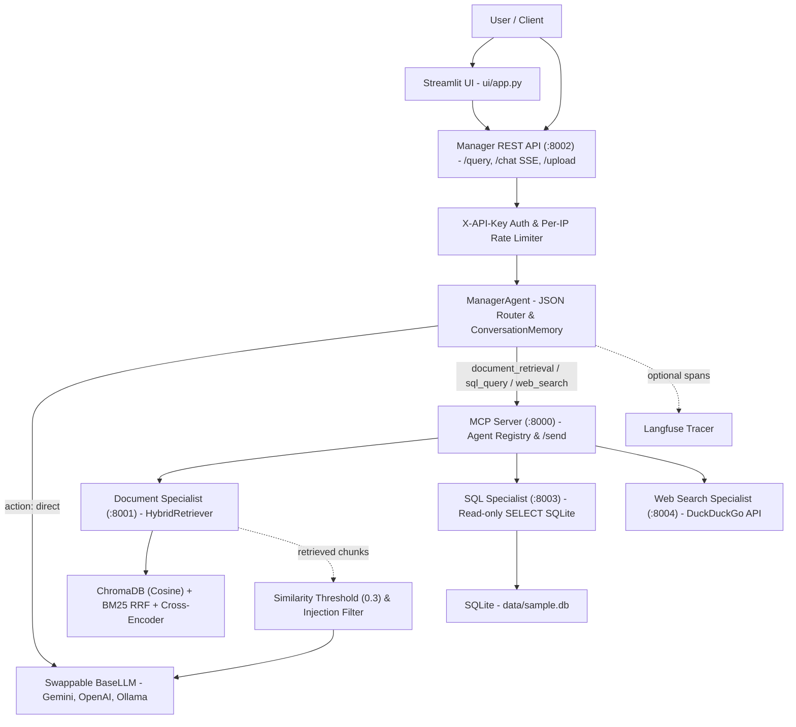

# Multi-Agent Document Analysis System

A multi-agent RAG system built on FastAPI, ChromaDB, and a lightweight Model Context Protocol (MCP) message bus. A Manager Agent classifies incoming queries via structured JSON routing, dispatches work to Document, SQL, or Web Search specialists, checks retrieval relevance and prompt-injection guardrails, and streams grounded answers with source citations.

[](https://github.com/YOUR_USERNAME/Multi-Agent-Document-Analysis-System/actions)
[](https://www.python.org/downloads/)
[](LICENSE)

## Architecture



## Capabilities

- **Structured Multi-Agent Routing:** `ManagerAgent` emits JSON routing decisions across four paths: `document_retrieval`, `sql_query`, `web_search`, and `direct`, with rolling multi-turn `ConversationMemory`.
- **Hybrid Retrieval + Re-ranking:** Combines dense cosine vector search (`all-MiniLM-L6-v2` in ChromaDB) and `BM25Okapi` via Reciprocal Rank Fusion (`rrf_k: 60`), plus an optional `ms-marco-MiniLM-L-6-v2` cross-encoder re-ranker.
- **Swappable LLM Backends:** Unified `BaseLLM` interface with Google Gemini, OpenAI, and local Ollama implementations configured via `config.yaml`, wrapped in `tenacity` retries.
- **Specialists over MCP:** Document retriever (`SpecialistAgent`), read-only `SELECT` SQLite runner (`SQLSpecialistAgent`), and DuckDuckGo search (`WebSearchSpecialistAgent`) register dynamically with the MCP server.
- **Multi-Format Ingestion:** Recursive and sentence-aware chunking for `.txt`, `.pdf` (`pypdf`), and `.docx` (`python-docx`) files, plus live indexing via `POST /upload`.
- **Streaming & UI:** `GET /chat` Server-Sent Events endpoint paired with a Streamlit chat frontend (`ui/app.py`) showing streaming tokens, expandable source citations, agent routing, and document upload.
- **Production Guardrails:** Minimum cosine similarity threshold (`Not found in documents` on low-relevance hits), regex-based prompt-injection filtering on retrieved chunks, optional `X-API-Key` auth, per-IP sliding-window rate limiting, and optional Langfuse tracing.

## Retrieval Evaluation

Measured on 30 questions across the 5-document baseline corpus ([eval/golden_qa.yaml](eval/golden_qa.yaml)):

| Metric | Dense Only (Baseline) | Hybrid BM25 + Dense (RRF) |
|---|---:|---:|
| Recall@1 | 0.233 | **0.367** |
| Recall@3 | 0.500 | **0.600** |
| Recall@5 | 0.767 | 0.733 |
| Recall@10 | 0.867 | **0.933** |
| MRR | 0.439 | **0.536** |

Run the offline evaluation harness:

```bash
python eval/run_eval.py --no-ragas
```

Settings are controlled in [config.yaml](config.yaml):

```yaml
retrieval:
  top_k: 5
  similarity_threshold: 0.3
  hybrid: true
  rerank: false
  rrf_k: 60
chunking:
  strategy: recursive
```

## Quickstart

### 1. Install and Configure

```bash
python -m venv venv
venv\Scripts\activate          # Windows
# source venv/bin/activate     # Mac/Linux

pip install -r requirements.txt
cp .env.example .env
```

Set `GEMINI_API_KEY` in `.env` (or switch `llm.provider` to `openai` or `ollama` in `config.yaml`).

### 2. Index Sample Documents

```bash
python setup_knowledge_base.py
```

### 3. Start Services

Run in separate terminals:

```bash
# Terminal 1: MCP message router (:8000)
python run_mcp_server.py

# Terminal 2: Document specialist (:8001)
python run_specialist.py

# Optional additional specialists:
# python run_sql_specialist.py   # SQL specialist (:8003)
# python run_web_search.py       # Web search specialist (:8004)

# Terminal 3: Manager REST API (:8002) or interactive CLI
python run_api.py
# python run_manager.py

# Terminal 4 (optional): Streamlit chat UI (:8501)
streamlit run ui/app.py
```

Or launch with Docker Compose:

```bash
docker-compose up --build
```

### Example Requests

```bash
# Standard JSON query
curl -X POST http://localhost:8002/query \
  -H "Content-Type: application/json" \
  -d '{"question": "What is the churn model AUC-ROC?"}'

# SSE streaming chat
curl -N "http://localhost:8002/chat?q=How+does+the+ELT+pipeline+work"

# Upload a new document (.txt, .pdf, .docx)
curl -X POST http://localhost:8002/upload \
  -F "file=@data/rag_lewis_2020.pdf"
```

Include `-H "X-API-Key: <your-key>"` when `API_KEY` is set in `.env`.

## API & MCP Reference

### Manager REST API (`:8002`)

| Endpoint | Method | Description |
|---|---|---|
| `/query` | `POST` | Synchronous question routing and answer synthesis |
| `/chat` | `GET` | Token-streamed answer via Server-Sent Events (`?q=...`) |
| `/upload` | `POST` | Multipart upload (`.txt`, `.pdf`, `.docx`) into ChromaDB |
| `/health` | `GET` | Service status and manager readiness |
| `/docs` | `GET` | OpenAPI / Swagger UI |

### MCP Server (`:8000`)

- `GET /mcp/v1/tools` — list registered specialist tools
- `POST /mcp/v1/tools/{tool_name}/invoke` — invoke a tool by name
- `POST /register`, `GET /agents`, `POST /send` — agent registration, discovery, and message dispatch

## Project Layout

```text
rag_system/
├── agents/
│   ├── manager.py          # JSON routing, memory, guardrails, synthesis
│   ├── memory.py           # Rolling ConversationMemory window
│   ├── specialist.py       # Document retrieval specialist
│   ├── sql_specialist.py   # Read-only SQLite query specialist
│   └── web_search.py       # DuckDuckGo specialist with tenacity retries
├── api/
│   └── app.py              # FastAPI REST + SSE server, auth, rate limit, /upload
├── knowledge_base/
│   ├── base_store.py       # BaseVectorStore interface + ChromaVectorStore
│   ├── loader.py           # .txt, .pdf, .docx loading + recursive chunking
│   ├── retriever.py        # HybridRetriever (BM25 + Dense + RRF + CrossEncoder)
│   └── vector_store.py     # ChromaDB cosine wrapper
├── llm/
│   ├── base.py             # BaseLLM & LLMConfig abstractions
│   ├── factory.py          # Config-driven provider factory
│   ├── gemini.py           # Google Gemini backend
│   ├── ollama.py           # Local Ollama backend
│   └── openai_llm.py       # OpenAI-compatible backend
├── mcp_server/
│   ├── models.py           # Message, Tool, AgentRegistration schemas
│   ├── registry.py         # Agent registry
│   └── server.py           # MCP HTTP endpoints
└── utils/
    ├── logging_config.py   # Loguru rotation & JSON log option
    ├── metrics.py          # Query timing and success metrics
    ├── security.py         # Prompt-injection detection & chunk filtering
    └── tracing.py          # Optional Langfuse tracing with no-op fallback

ui/app.py                   # Streamlit chat interface
eval/                       # Golden QA dataset (30 Qs) & eval runner
data/                       # Public arXiv PDFs, text corpus, and SQLite demo DB
docs/                       # Sample knowledge-base files & deployment guide
tests/                      # Unit and integration tests
run_*.py                    # Entry points (MCP, specialists, API, CLI)
```

## Design Decisions

| Component | Choice | Rationale |
|---|---|---|
| Vector Store | ChromaDB behind `BaseVectorStore` | Local persistence with zero external infra; swappable via base class |
| Hybrid Search | BM25 + Cosine Dense + RRF (`k=60`) | Captures exact terms (model names, metrics) alongside semantics; +57% Recall@1 over dense alone |
| Chunking | Recursive (`500` chars, `50` overlap) | Preserves paragraph/sentence boundaries better than fixed slices |
| LLM Layer | `BaseLLM` + `tenacity` backoff | Provider-agnostic switching between Gemini, OpenAI, and Ollama; resilient to transient 429s |
| Agent Bus | HTTP/JSON MCP server | Keeps specialists decoupled and independently deployable |
| SQL Safety | Keyword blocklist + `SELECT` check | Enforced in Python (`_is_safe`) rather than trusting LLM prompt compliance |
| Guardrails | Score gate + regex injection filter | Rejects off-topic context (`< 0.3` similarity) and drops/redacts override payloads before synthesis |
| Observability | Optional Langfuse `Tracer` | Instruments route/retrieve/synthesize spans when keys are set; degrades to no-op locally |

## Deployment

See [docs/deployment.md](docs/deployment.md) and [render.yaml](render.yaml) for Render Blueprint and Docker deployment instructions.

## Testing & CI

CI runs on push and pull requests via [.github/workflows/ci.yml](.github/workflows/ci.yml) (`ruff check`, `pytest` with coverage, and `docker build`):

```bash
ruff check rag_system tests
pytest tests/ -v --cov=rag_system --cov-report=term-missing
```
